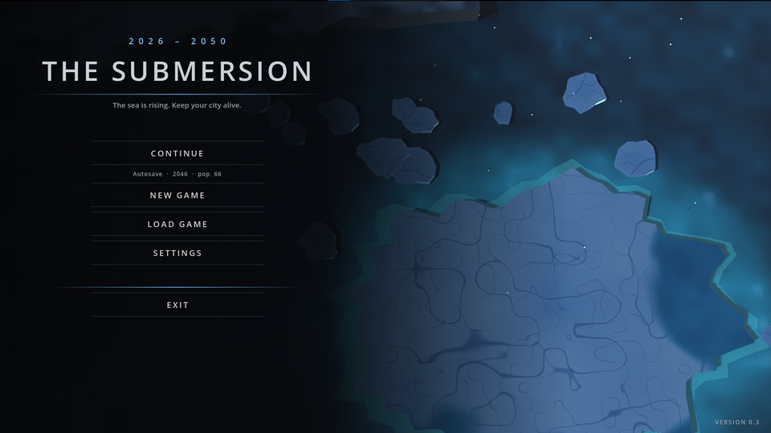
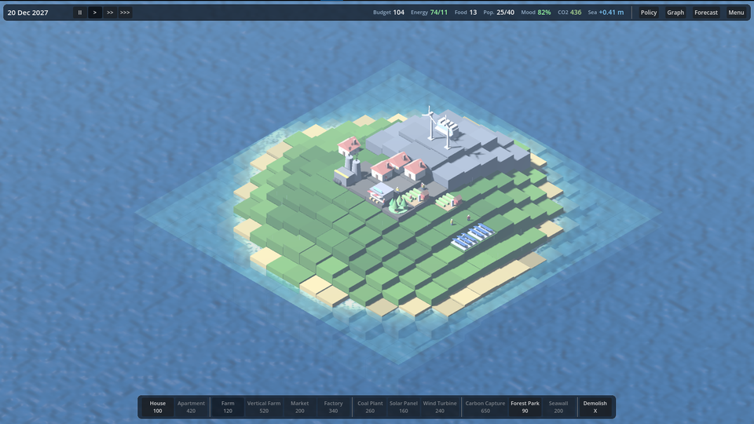
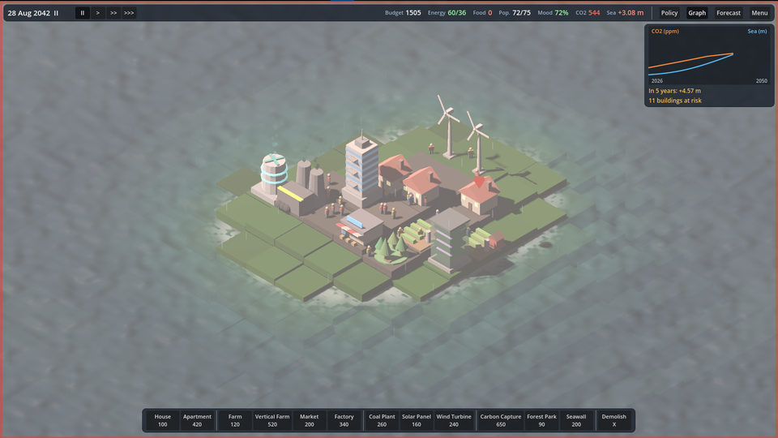
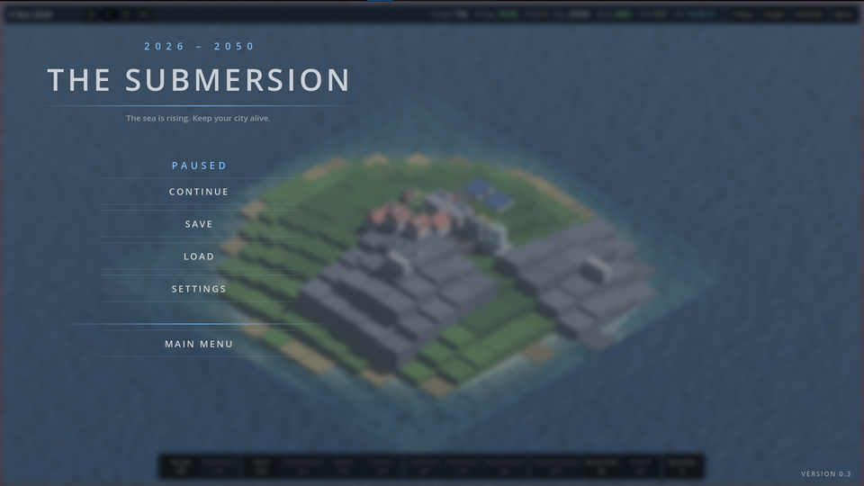

<div align="center">


# THE SUBMERSION

### The sea is rising. Keep your city alive from 2026 to 2050.

*A real-time climate-survival city builder: wall out the water, or fix the climate that is flooding you.*


**English** · [Türkçe](README.tr.md)

[About](#-about-the-game) · [COP31 themes](#-built-for-the-cop31-themes) · [How a run works](#-how-a-run-works) · [Screenshots](#-screenshots) · [Play / Install](#-play--install) · [Controls](#-controls) · [Roadmap](#-roadmap)

</div>

---

<p align="center">
  
</p>

## 🌊 About the Game

**The Submersion** is a real-time city-management and survival game set between **2026 and 2050**. You govern an island city on a shrinking circle of land while the sea climbs. Every building you place changes the city's budget, power, food and mood, **and** the carbon in the atmosphere. That carbon decides how fast the water rises.

| | |
|---|---|
| **Genre** | Real-time strategy, survival & city builder (isometric 3D) |
| **Platform** | Windows (Godot export), Linux/macOS via Godot export. Runs from source on any machine that runs Godot 4 |
| **Players** | Single player |
| **Session length** | About 7 minutes at normal speed (the full 24 years) |
| **Languages** | English (default) and Turkish, switchable in Settings |
| **Made for** | The GameUp Türkiye game hackathon, built in a 48-hour development window |

### The story

> It is 2026. The climate crisis has crossed its tipping point and the sea begins to rise. You are the administrator of a city on the edge of disaster. With a limited budget and a restless population, you must stop the city from sinking, and you must keep it standing until 2050.

### The core dilemma

Every run comes down to one question:

- **Treat the symptom.** Build seawalls and defences with your money. They buy time, but walls wear down and the carbon keeps flowing, so the sea rises faster later.
- **Treat the cause.** Switch to clean energy, tax carbon, and build carbon capture. The city gets poorer and angrier in the short term (blackouts, unrest), but if CO₂ really falls, **the sea slows and can even retreat**.

Most winning runs mix both. **Doing nothing always loses**: the starting district floods in the 2040s and the population and mood fall below the survival line.

### Key features

- 🌍 **Carbon drives the sea.** Your emissions set the CO₂ level (ppm); the CO₂ level sets how fast the sea rises, and it accelerates past 480 ppm. Push CO₂ under 400 ppm and the water slows, then recedes.
- 🏙️ **12 buildings with real trade-offs:** houses, apartments, farms, vertical farms, markets, factories, coal plants, solar panels, wind turbines, carbon capture, forest parks, and seawalls.
- 🏗️ **Vertical architecture.** Apartments and vertical farms survive floods **1.2 m higher**, and houses and farms can be **upgraded in place**.
- 🔮 **Flood forecast overlay.** Red tiles flood within about 2 years, orange within about 5. Plan before the water arrives.
- 🌊 **Living coastline.** A depth-aware water shader, shoreline foam, wet-sand tinting, storm surges, and buildings that visibly sink when lost.
- ⚖️ **Policies and dilemmas.** Fossil-fuel ban, carbon tax, green subsidy, plus events such as climate refugees, heat waves, storm surges, droughts, and a COP green fund offer.
- ⛈️ **Dynamic weather.** Clear, cloudy, drizzle, rain, heavy rain and thunderstorms with lightning. There is no day/night cycle, because one second is one day.
- 🎬 **Six endings** with their own cinematic sequence (see below).
- 🧰 **Quality of life.** Drag-to-box-select, in-place upgrades, 3 save slots plus yearly autosave, fully rebindable keys, dismissible tips, a low-graphics mode, UI scaling, and resolution-independent mouse picking.
- 🎨 **Zero external assets required.** All sound and music are synthesised in code, buildings are modelled in code, and the menu scenery is generated procedurally.

## 🌍 Built for the COP31 Themes

The game was designed around the four hackathon themes:

| COP31 theme | How it appears in the game |
|---|---|
| **Renewable energy & sustainability** | Coal is cheap and strong but dirty. Solar and wind are clean but weaker, and wind needs high ground. Blackouts slow the whole economy and anger the people. |
| **Carbon footprint & conscious consumption** | Every building has a carbon cost. A carbon tax, green subsidy and fossil ban change what is worth building, and every choice shows up in the CO₂ curve. |
| **Oceans & seas** | Sea-level rise is the central mechanic: accelerating with CO₂, flooding land tile by tile, surging in storms, and able to recede if you clean up the atmosphere. |
| **Climate-resilient cities** | Seawalls, vertical architecture, in-place upgrades and the flood forecast teach resilience: adapt to what is coming **and** reduce what causes it. |

## 🎮 How a run works

1. **Start paused.** You begin in 2026 with a small town. Place a few buildings in peace.
2. **Press play.** Time runs from 2026 to 2050 at three speeds (about 8 / 20 / 50 days per second). Pause at any time. You can still build and demolish while paused.
3. **Balance the city.** Keep **power**, **food**, **housing** and **jobs** healthy so that **mood** stays up. If mood reaches zero, the people revolt.
4. **Watch the sea.** Check the forecast, the CO₂ and sea graph, and the risk markers above buildings. Build walls, upgrade, or cut emissions.
5. **Face the dilemmas.** Every so often an event asks for a decision. Some choices cost money, some cost carbon, some cost trust.
6. **Reach 2050.** To survive you need at least **40 people and 30% mood** in 2050. How you get there decides which ending you see.

The game starts gentle and ramps up. Sea rise begins at 40% speed and reaches full strength around 2034, and the early events are mild.

### Endings

| Ending | When |
|---|---|
| 🟢 **Green Future** | Reach 2050 with CO₂ **below 400 ppm** |
| 🟡 **A Costly Survival** | Reach 2050 with CO₂ between 400 and 480 ppm |
| 🔵 **Behind the Walls** | Reach 2050 with CO₂ **above 480 ppm** |
| 🟠 **The City Fades** | Reach 2050, but with fewer than 40 people or under 30% mood |
| 🔴 **People's Revolt** | Mood hits zero |
| 🌊 **The City Emptied** | Every building is lost or the population collapses |

## 🖼️ Screenshots

<table>
  <tr>
    <td align="center"><br/><sub><b>2027:</b> an early town with power, farms and the build bar</sub></td>
    <td align="center"><br/><sub><b>2042:</b> the climate graph shows the 5-year forecast and buildings at risk</sub></td>
  </tr>
  <tr>
    <td align="center"><br/><sub><b>Main menu:</b> a bird's-eye ice shelf, broken off from the land and melting</sub></td>
    <td align="center"><br/><sub><b>Pause menu</b> over the blurred, frozen city</sub></td>
  </tr>
</table>

> 🎥 **Gameplay video:** a gameplay video will be linked here.

## 🛠️ Tech Stack

| | |
|---|---|
| **Engine** | [Godot 4](https://godotengine.org) (developed with 4.7.1), standard build |
| **Language** | GDScript |
| **Renderer** | **GL Compatibility**, so it runs on older GPUs and integrated graphics without Vulkan |
| **Graphics** | Custom spatial shaders (depth-aware water driven by a terrain height texture, procedural ice and rock), CPU particles, procedural meshes |
| **Audio** | All effects and music **synthesised at runtime** (`AudioStreamWAV`). Optional drop-in `.ogg/.wav/.mp3` replacements with random variants |
| **Models** | Buildings modelled in code. Optional **Blender 3.6/4.x** Python script exports `.glb` models that the game picks up automatically |
| **Localisation** | Godot `TranslationServer`, with English and Turkish |
| **Libraries / plugins** | None. No third-party dependencies |
| **Tooling** | Git, Blender, and the Claude AI assistant (Anthropic) as a coding and pair-programming aid |

## 🚀 Play & Install

### For players

1. Open the **[Releases page](https://github.com/YOUR-USERNAME/the-submersion/releases)** and download the latest build for your system.
2. Extract the archive and run the executable.
3. Press **New Game**, place a few buildings, then press **▶** to start the clock.

No installation or special graphics card is needed.

### For developers

**Requirements:** [Godot 4.x](https://godotengine.org/download) (standard version, not .NET). Nothing else.

```bash
# 1. Clone the repository
git clone https://github.com/YOUR-USERNAME/the-submersion.git
cd the-submersion
```

2. Open **Godot** and click **Import**.
3. Select `project.godot` in the cloned folder and press **Import & Edit**.
4. If you see autoload or class errors on the very first import, use **Project → Reload Current Project** once.
5. Press **F5** (Run). The main scene is `main.tscn`.

**Optional: generate the 3D models with Blender**

1. Open Blender and go to the **Scripting** tab.
2. Open `blender/generate_models.py` and set `OUT_DIR` to this project's `models/` folder.
3. Press **Run Script**. It writes 15 `.glb` files (12 buildings plus 3 citizens). Godot imports them and uses them automatically. Without them, the code-built models are used.

**Optional: use your own sounds.** Put `.ogg/.wav/.mp3` files in `audio/` (for example `thunder.ogg`, `thunder_2.ogg`, or a `thunder/` folder). They replace the synthesised sound, and several variants are played at random. See [`audio/README.txt`](audio/README.txt).

**Export a build:** *Project → Export*, add a preset, make sure **GL Compatibility** is kept, and export.

## ⌨️ Controls

Defaults are shown below. **Every key marked ✱ can be rebound** in *Settings → Controls*.

| Input | Action |
|---|---|
| **Left click** | Place the selected building / select a tile |
| **Left click + drag** | **Box select**. With a building selected it fills the area, with *Demolish* it clears the area, with no tool it selects buildings |
| **Right click** / **Esc** | Cancel the tool or selection. Esc again opens the pause menu |
| **W A S D** ✱ / **Arrow keys** | Move the camera |
| **Middle mouse drag** | Pan the camera |
| **Q / E** ✱ | Rotate the view |
| **Mouse wheel** | Zoom |
| **Space** ✱ | Pause / resume |
| **,** and **.** ✱ | Slow down / speed up time |
| **T** ✱ | Toggle the flood forecast |
| **U** ✱ | Upgrade the selected building |
| **X** ✱ | Demolish tool |
| **1 – 0, -, =** | Select a building from the build bar |

Hover over anything for a short explanation. Tips appear as you play and can be turned off.

## 🗂️ Project Structure

```
.
├── project.godot            Godot project (GL Compatibility)
├── main.tscn                The only scene; everything else is built in code
├── scripts/
│   ├── game_manager.gd      Autoload "Game": time, economy, carbon, sea level, floods, events, save/load
│   ├── game_data.gd         All balance numbers: buildings, events, constants
│   ├── world.gd             Terrain, water, flood visuals, picking, forecast overlay
│   ├── weather.gd           Dynamic weather and lightning
│   ├── hud.gd, graph.gd     Minimal HUD and the climate graph
│   ├── menu.gd, menu_backdrop.gd, ui_style.gd   Menus, settings, the melting ice shelf scene
│   ├── ending.gd            Cinematic ending screens
│   ├── building*.gd, citizens.gd   Buildings, procedural models, wandering citizens
│   ├── audio_manager.gd     Synthesised sound and music, drop-in overrides
│   ├── settings.gd, lang_data.gd   Settings, key bindings, English/Turkish text
│   └── main.gd, camera_rig.gd, tutorial.gd
├── blender/generate_models.py   Optional Blender model generator
├── audio/                   Optional drop-in sounds
└── docs/images/             README screenshots
```

## 🛣️ Roadmap

- [x] **Hackathon build (November 2026):** a complete, playable vertical slice, from main menu to six endings
- [ ] **Beyond the hackathon build:** more content, balance and polish, **by New Year 2027**
- [ ] **Comprehensive public demo:** January 2027
- [ ] **Full release on game platforms:** by mid-2027

Ideas being considered: five-yearly COP summit goals, more events and building types, multiple island maps and scenarios, an endless mode, and a full art and audio pass.

## 👤 Author

**Ensar Muhammed Işık**, Game Developer & Designer
A 12th-grade student at Balıkesir Şehit Turgut Solak Science High School. Solo developer, with earlier experience building isometric survival strategy games in Godot.

## 🙏 Credits

- Built for the **GameUp Türkiye** game hackathon (COP31 climate themes).
- Cover art: concept art created for the hackathon presentation.
- Engine: [Godot](https://godotengine.org) (MIT licensed). All code, sound synthesis, shaders and in-game models in this repository are original to the project.

---

<div align="center">

*The sea does not negotiate. The question is how much time you buy, and what you do with it.*

</div>
