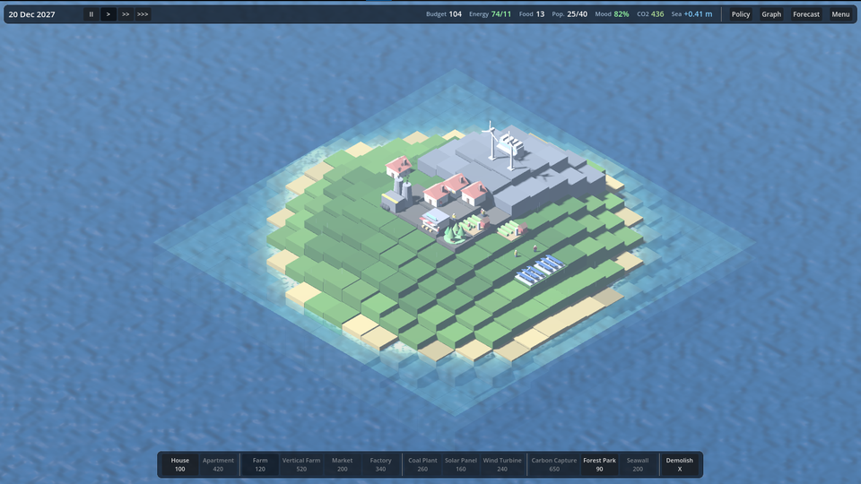
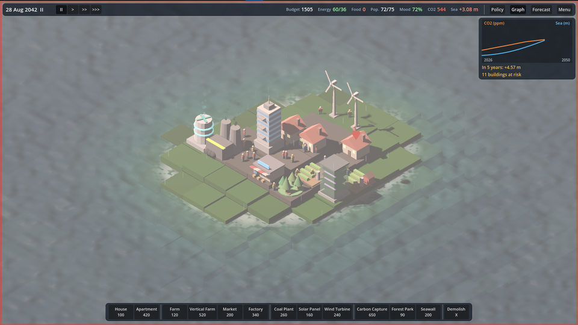
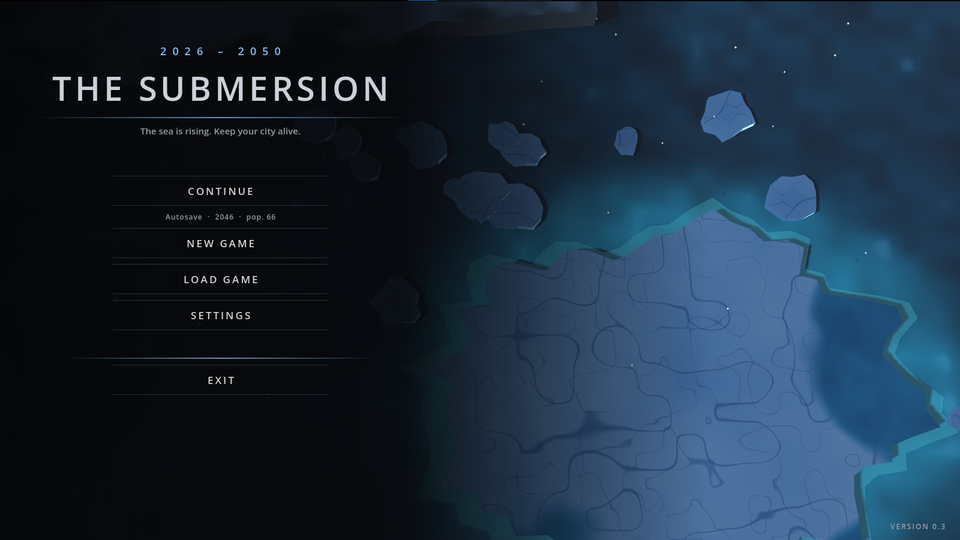
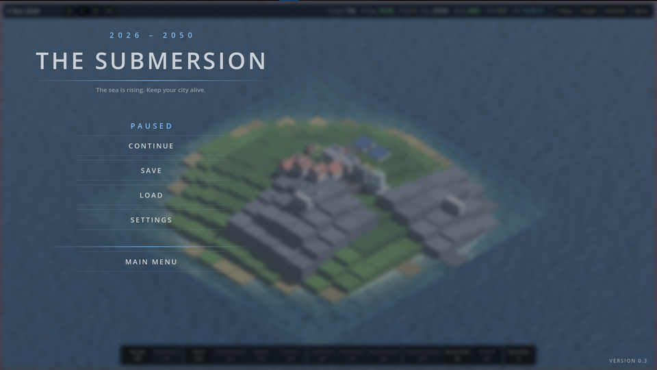

# THE SUBMERSION

### Deniz yükseliyor. Şehrini 2026'dan 2050'ye ayakta tut.

*Gerçek zamanlı bir iklim hayatta kalma ve şehir kurma oyunu: suyu duvarla mı durduracaksın, yoksa seni boğan iklimi mi onaracaksın?*

[English](README.md) · **Türkçe**

[Oyun Hakkında](#-oyun-hakkında) · [COP31 Temaları](#-cop31-temaları-için-tasarlandı) · [Bir Oyun Nasıl İşler](#-bir-oyun-nasıl-işler) · [Görseller](#-ekran-görüntüleri) · [Kontroller](#-kontroller)

---

## 🌊 Oyun Hakkında

**The Submersion**, **2026 ile 2050** arasında geçen, gerçek zamanlı bir şehir yönetimi ve hayatta kalma oyunudur. Deniz yükselirken daralan bir kara parçası üzerindeki ada şehrini yönetirsin. Koyduğun her bina şehrin bütçesini, enerjisini, gıdasını ve moralini değiştirir, **ve** atmosferdeki karbonu da değiştirir. Suyun ne kadar hızlı yükseleceğini bu karbon belirler.

| | |
|---|---|
| **Tür** | Gerçek zamanlı strateji, hayatta kalma ve şehir kurma (izometrik 3D) |
| **Platform** | Windows (Godot export). Linux/macOS için de Godot ile export edilebilir. Godot 4 çalışan her bilgisayarda kaynaktan açılır |
| **Oyuncu** | Tek oyunculu |
| **Diller** | İngilizce ve Türkçe, ayarlardan değiştirilir |
| **Amaç** | GameUp Türkiye oyun hackathonu için, 48 saatlik bir geliştirme süresinde yapıldı |

### Hikaye

> Yıl 2026. İklim krizi geri dönülemez noktayı aşar ve deniz yükselmeye başlar. Sen, felaketin eşiğindeki bir şehrin yöneticisisin. Sınırlı bir bütçe ve huzursuz bir halkla şehrin sular altında kalmasını engellemek ve onu 2050'ye kadar ayakta tutmak zorundasın.

### Ana ikilem

Her oyun tek bir soruya varır:

- **Belirtiyi tedavi et.** Paranla set ve savunma yap. Zaman kazandırır, ama duvarlar yıpranır ve karbon akmaya devam eder; deniz sonradan daha hızlı yükselir.
- **Nedeni tedavi et.** Temiz enerjiye geç, karbonu vergilendir, karbon yakalama kur. Kısa vadede şehir fakirleşir ve öfkelenir (elektrik kesintileri, huzursuzluk). Ama CO₂ gerçekten düşerse **deniz yavaşlar, hatta geri çekilebilir**.

### Öne çıkan özellikler

-  **Karbon denizi yönetir.** Salımların CO₂ seviyesini (ppm) belirler; CO₂ seviyesi denizin yükselme hızını belirler ve 480 ppm'in üstünde hızlanır. CO₂'yi 400 ppm'in altına çekersen su yavaşlar, sonra geri çekilir.
-  **Gerçek ödünleşimleri olan 12 bina:** konut, apartman, tarla, dikey çiftlik, pazar, fabrika, kömür santrali, güneş paneli, rüzgar türbini, karbon yakalama, orman park ve set.
-  **Dikey mimari.** Apartmanlar ve dikey çiftlikler seli **1,2 m daha yüksek** atlatır; konutlar ve tarlalar **yerinde yükseltilebilir**.
-  **Sel tahmini katmanı.** Kırmızı kareler yaklaşık 2 yıl, turuncu kareler yaklaşık 5 yıl içinde batar. Su gelmeden planla.
-  **Yaşayan kıyı.** Derinliğe duyarlı su shader'ı, kıyı köpüğü, ıslak kum tonu, fırtına dalgaları ve kaybedildiğinde gözle görülür şekilde batan binalar.
-  **Politikalar ve ikilemler.** Fosil yakıt yasağı, karbon vergisi, yeşil teşvik; ayrıca iklim mültecileri, sıcak dalgası, fırtına dalgası, kuraklık ve COP yeşil fon teklifi gibi olaylar.
-  **Dinamik hava durumu.** Açık, bulutlu, çisenti, yağmur, şiddetli yağış ve yıldırımlı fırtına. Bir saniye bir gün olduğu için gece-gündüz döngüsü yoktur.
-  Her biri kendi sinematik anlatımına sahip **altı son** (aşağıya bak).
-  **Kullanım kolaylığı.** Sürükleyerek kutu seçimi, yerinde yükseltme, 3 kayıt yuvası ve yıllık otomatik kayıt, tamamen değiştirilebilir tuşlar, kapatılabilir ipuçları, düşük grafik modu, arayüz ölçeği ve çözünürlükten bağımsız fare seçimi.

  
## 🌍 COP31 Temaları İçin Tasarlandı

Oyun, hackathonun dört temasının etrafında tasarlandı:

| COP31 teması | Oyunda nasıl görünür |
|---|---|
| **Yenilenebilir enerji ve sürdürülebilirlik** | Kömür ucuz ve güçlü ama kirlidir. Güneş ve rüzgar temiz ama daha zayıftır; rüzgar yüksek zemin ister. Elektrik kesintileri tüm ekonomiyi yavaşlatır ve halkı öfkelendirir. |
| **Karbon ayak izi ve bilinçli tüketim** | Her binanın bir karbon bedeli vardır. Karbon vergisi, yeşil teşvik ve fosil yasağı neyin inşa edilmeye değer olduğunu değiştirir; her seçim CO₂ eğrisinde görünür. |
| **Okyanuslar ve denizler** | Deniz seviyesi yükselmesi ana mekaniktir: CO₂ ile hızlanır, araziyi kare kare sular altında bırakır, fırtınalarda dalgalanır ve atmosferi temizlersen geri çekilebilir. |
| **İklim dirençli şehirler** | Setler, dikey mimari, yerinde yükseltme ve sel tahmini dayanıklılığı öğretir: gelene **uyum sağla** ve nedeni **azalt**. |

## Bir Oyun Nasıl İşler

1. **Başla.** 2026'da küçük bir kasabayla başlarsın. Birkaç binayı sakin sakin yerleştir.
2. **Şehri dengede tut.** **Elektrik**, **gıda**, **barınma** ve **iş** sağlıklı olsun ki **moral** yüksek kalsın. Moral sıfıra inerse halk isyan eder.
3. **Denizi izle.** Tahmini, CO₂ ve deniz grafiğini, binaların üstündeki risk işaretlerini kontrol et. Set kur, yükselt ya da salımları azalt.
4. **İkilemlerle yüzleş.** Zaman zaman bir olay karar ister. Bazı seçimler para, bazıları karbon, bazıları güven kaybettirir.
5. **2050'ye ulaş.** Hayatta kalmak için 2050'de en az **40 kişi ve %30 moral** gerekir. Oraya nasıl vardığın, hangi sonu göreceğini belirler.

### Sonlar

| Son | Ne zaman |
|---|---|
| 🟢 **Yeşil Gelecek** | 2050'ye CO₂ **400 ppm'in altında** ulaşmak |
| 🟡 **Bedeli Ağır Kurtuluş** | 2050'ye CO₂ 400 ile 480 ppm arasında ulaşmak |
| 🔵 **Duvarların Arkasında** | 2050'ye CO₂ **480 ppm'in üstünde** ulaşmak |
| 🟠 **Şehir Sönüyor** | 2050'ye ulaşmak, ama 40 kişiden az nüfus ya da %30'un altında moralle |
| 🔴 **Halk İsyanı** | Moralin sıfıra düşmesi |
| 🌊 **Şehir Boşaldı** | Tüm binaların kaybedilmesi ya da nüfusun çökmesi |

## Ekran Görüntüleri

<table>
  <tr>
    <td align="center"> <b>2027:</b> elektrik, tarla ve inşa çubuğuyla erken bir kasaba</td>
    <td align="center"> <b>2042:</b> iklim grafiği 5 yıllık tahmini ve riskteki binaları gösterir</td>
  </tr>
  <tr>
    <td align="center"> <b>Ana menü:</b> karadan kopmuş ve eriyen, kuşbakışı bir buz kütlesi</td>
    <td align="center"> <b>Duraklatma menüsü:</b> bulanık, donmuş şehrin üstünde</td>
  </tr>
</table>

## Kullanılan Teknolojiler

| | |
|---|---|
| **Oyun motoru** | [Godot 4](https://godotengine.org) (4.7.1 ile geliştirildi), standart sürüm |
| **Dil** | GDScript |
| **Renderer** | **GL Compatibility**: Vulkan olmayan eski ekran kartlarında ve ekran kartı olmayan bilgisayarlarda da çalışır |
| **Grafik** | Özel spatial shader'lar (arazi yükseklik dokusuyla beslenen derinlik duyarlı su, prosedürel buz ve kaya), CPU parçacıkları, prosedürel mesh'ler |
| **Ses** | Tüm efektler ve müzik **çalışma anında üretilir** (`AudioStreamWAV`). İsteğe bağlı `.ogg/.wav/.mp3` dosyaları, rastgele varyantlarla yerine geçebilir |
| **Modeller** | Binalar kodla modellenir. İsteğe bağlı **Blender 3.6/4.x** Python betiği `.glb` modelleri üretir ve oyun bunları otomatik kullanır |
| **Yerelleştirme** | Godot `TranslationServer`, İngilizce ve Türkçe |
| **Kütüphane / eklenti** | Yok. Üçüncü taraf bağımlılık yoktur |
| **Araçlar** | Git, Blender ve kod yazımında yardımcı olarak Claude yapay zeka asistanı (Anthropic) |

## Kontroller

Varsayılanlar aşağıdadır. **✱ işaretli her tuş** *Ayarlar → Kontroller* bölümünden değiştirilebilir.

| Girdi | Eylem |
|---|---|
| **Sol tık** | Seçili binayı yerleştir / kareyi seç |
| **Sol tık + sürükle** | **Kutu seçimi**. Bina seçiliyken alanı doldurur, *Yık* ile alanı temizler, araç yokken binaları seçer |
| **Sağ tık** / **Esc** | Aracı ya da seçimi iptal et. Tekrar Esc duraklatma menüsünü açar |
| **W A S D** ✱ / **Ok tuşları** | Kamerayı hareket ettir |
| **Orta tuş sürükle** | Kamerayı kaydır |
| **Q / E** ✱ | Görünümü döndür |
| **Fare tekerleği** | Yakınlaştır |
| **Boşluk** ✱ | Duraklat / devam et |
| **,** ve **.** ✱ | Zamanı yavaşlat / hızlandır |
| **T** ✱ | Sel tahminini aç / kapat |
| **U** ✱ | Seçili binayı yükselt |
| **X** ✱ | Yık aracı |
| **1 – 0, -, =** | İnşa çubuğundan bina seç |

Her şeyin üstüne gelince kısa bir açıklama çıkar. İpuçları oynarken görünür ve kapatılabilir.

---

Teşekkürler
